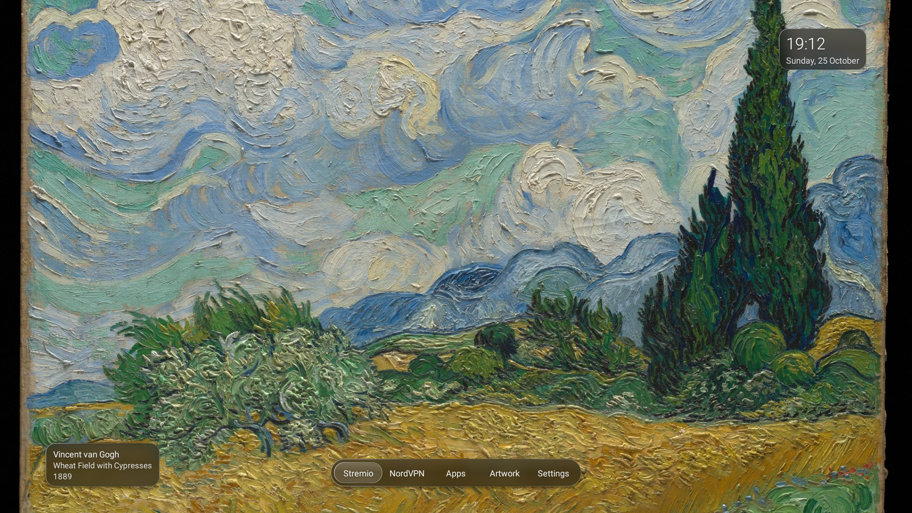
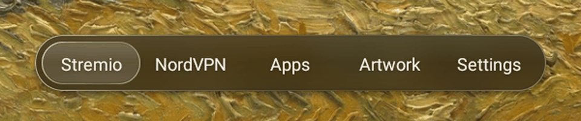
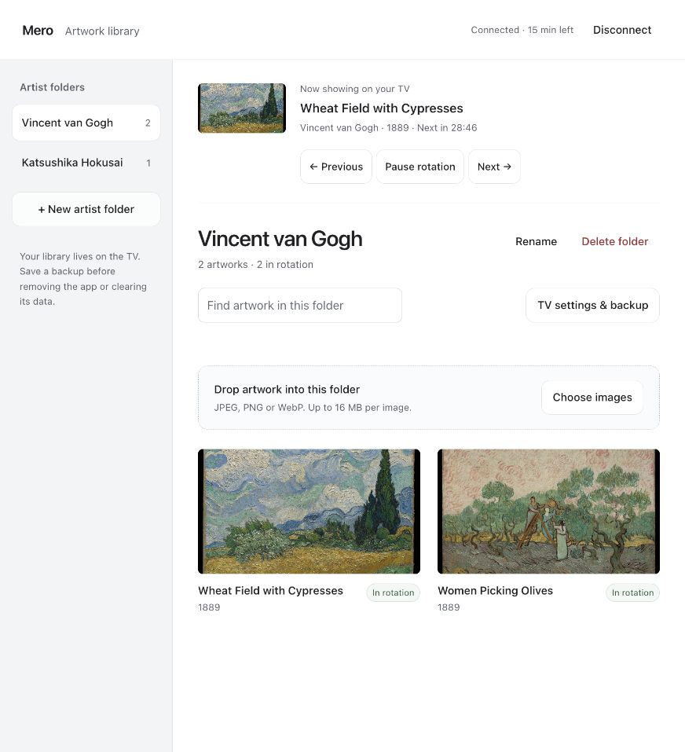
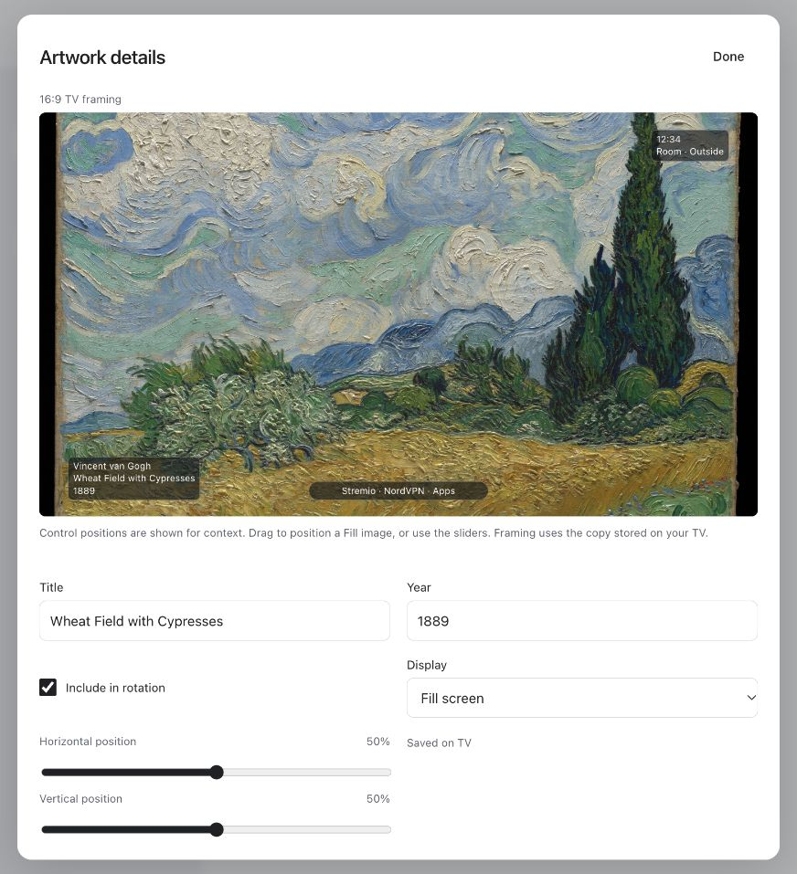

# Mero

An artful home for Android TV and Google TV, by INVRSE. Fullscreen art, two app shortcuts and a small clock. Manage the collection from your phone.



## What it does

- Display fullscreen artwork with artist, title and year.
- Choose Fill or Fit and adjust the framing in a 16:9 preview.
- Create artist folders and upload images through a paired browser on your home network.
- Rotate selected works every 5, 15, 30, 60 or 120 minutes. Show a work immediately, pause, or skip.
- Open two configurable app shortcuts, all apps and settings with the remote.
- Hide the clock, caption and controls after one minute in Art mode. One remote press brings them back.
- Undo the latest deletion and export or restore the artwork library.
- Optionally display one or two Home Assistant readings. Disabled by default.

No account is needed for the launcher. No advertising or analytics. Artwork stays on the TV and remains available offline.



Cropped detail from captured TV frames. [Capture notes](docs/media.md).

[Watch the full-frame demo](docs/media/navigation.mp4)

## Try it

You need an Android TV or Google TV device, a remote, and a computer for sideloading. Android 8 or later is the build minimum. The glass blur uses Android 12 features, with a fallback on older versions.

**Tested hardware:** Sony XR-55X94J, Android 12. Other TVs and older Android versions need testing. This is an independent project, not a Sony, Google, Apple or Home Assistant product.

### Build the APK

Install JDK 17+, Python 3, Android SDK Platform 35 and Build Tools 35.0.0. Add Android Platform Tools to your `PATH` for `adb`.

```sh
export JAVA_HOME=/path/to/jdk-17
export ANDROID_HOME=/path/to/android-sdk
export PATH="$ANDROID_HOME/platform-tools:$PATH"

bash tools/build.sh
```

The APK is `output/apk/mero.apk`. A first development build creates an ignored local development signing key. Keep that key for your own updates. Release signing is separate; see [builds and releases](docs/development.md).

### Install over Wi-Fi

1. Enable Developer options and ADB debugging on the TV. Keep the computer and TV on a trusted home network.
2. Connect with `adb`. TVs with Wireless debugging show pairing and connection ports. Some Sony TVs instead expose legacy network debugging on port 5555.
3. Install the APK, then open **Mero** from the TV's apps.

```sh
# Use the address and connection port shown on your TV.
adb connect TV_IP:ADB_PORT
adb install -r output/apk/mero.apk
```

If the TV shows a pairing-code screen, run `adb pair TV_IP:PAIRING_PORT` first. Accept the computer on the TV when prompted. The [Android ADB guide](https://developer.android.com/tools/adb) explains both connection methods.

Choose Mero as the default Home app where your TV supports it. Sony may need the optional [Home-button helper](docs/install.md#sony-home-button-helper). Keep the original system launcher installed.

To try the UI without registering a Home app, build the separate preview package:

```sh
bash tools/build.sh --variant preview
adb install -r output/apk/mero-preview.apk
```

## Add your artwork

1. Open **Artwork → Manage library** on the TV.
2. Scan the QR code with your phone. It fills in the pairing code; select **Connect to TV**.
3. Create an artist folder and upload JPEG, PNG or WebP images, up to 16 MB each.
4. Open an artwork to edit its title, year, rotation selection and framing. Save, then select **Show on TV**.





The manager is available only while sharing is open and Mero stays on screen. Sharing closes after 30 minutes, when you leave the app, or when the screen turns off. Browser pairing expires after 15 minutes without use.

**TV settings & backup** contains the global rotation interval, Art mode and ZIP backup/restore. Back up before clearing app data or uninstalling. A restore replaces the current artwork library. Home Assistant credentials are excluded from backups.

The included demo collection uses [CC0 images from The Metropolitan Museum of Art](docs/artwork-credits.md). Bring images you have permission to use. HEIC is not accepted directly; export it as JPEG first if your phone does not convert it.

## Optional Home Assistant readings

The launcher works without Home Assistant. New installations make no Home Assistant requests and show no temperature panel.

To add readings, open **Settings → Home Assistant** and follow the [setup guide](docs/home-assistant.md). You supply your own HTTPS address, access token and one or two entity IDs. Labels and units are configurable. Disable the connection at any time to hide the panel and stop polling.

## What's used

| Part | Implementation |
|---|---|
| TV interface | Native Java and Android Views. No WebView or Compose dependency. |
| Glass and focus motion | Canvas, Android 12 `RenderEffect`, `ValueAnimator`, and an older-Android fallback. |
| Artwork manager | Bundled HTML, CSS and JavaScript served by a temporary Java socket server. |
| QR codes | Vendored [Nayuki QR Code generator](https://github.com/nayuki/QR-Code-generator), MIT licensed. Generated offline. |
| Artwork storage | Private app files, validated images, atomic JSON metadata and ZIP backups. |
| Home Assistant | Optional HTTPS state reads. Token encrypted with an app-owned Android Keystore key. |
| Build | JDK, Android SDK command-line tools, Python and shell scripts. No Gradle download. |
| Optional TV tools | Python [`adb-shell`](https://github.com/JeffLIrion/adb_shell) for legacy ADB connections. |

The glass treatment is inspired by Apple's material design. It uses Android APIs and includes no Apple framework or assets.

## Privacy and limits

- The artwork manager uses **local HTTP** with a temporary pairing code and browser session. Use a trusted LAN. It is separate from the HTTPS Home Assistant connection.
- Home Assistant tokens inherit their account's permissions. Use a dedicated read-only account. The app's read-only requests do not restrict the token itself.
- No automatic cloud sync, remote internet access or vendor integrations are included.
- Up to 200 artworks and 256 MiB of normalized artwork storage. Uploaded images are resized for TV use; keep your originals elsewhere.
- Art mode reduces fixed UI but does not guarantee burn-in protection. Keep the TV's own screen saver and sleep protection enabled. Developer options → Stay awake can prevent normal sleep.

## Development

Run the checks after building:

```sh
bash tools/test.sh
python3 tools/check-public.py
```

See [development and release signing](docs/development.md), [installation and rollback](docs/install.md), [contributing](CONTRIBUTING.md), and [security](SECURITY.md).

## License

Code is [MIT licensed](LICENSE). Artwork has separate [CC0 credits](docs/artwork-credits.md). Vendored notices are retained in [THIRD_PARTY_NOTICES.md](THIRD_PARTY_NOTICES.md).
