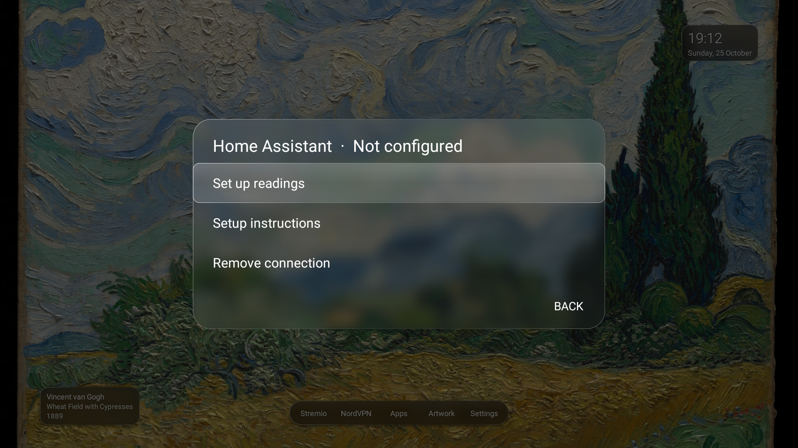

# Optional Home Assistant readings

Home Assistant is off on a fresh install. The launcher, artwork manager and rotation work without it.



## Configure

1. Use a dedicated read-only Home Assistant account and create an access token for the TV. Keep the token private.
2. Copy `examples/home-assistant.example.json` to a private file outside Git, such as `.local/home-assistant.json`.
3. Replace the example HTTPS address, token and entity IDs. Supply one or two entities. The labels and units can be changed.
4. Push the private file to the TV, using the package you installed:

```sh
adb push .local/home-assistant.json \
  /sdcard/Android/data/studio.invrse.mero/files/home-assistant.json
```

5. Open **Mero → Settings → Home Assistant** and check the setup, or restart the app.

For the preview package, use `studio.invrse.mero.preview` in the path. The Lab package uses `studio.invrse.mero.experiment`. The app shows its actual provisioning path in the setup dialog.

The app validates the configuration, encrypts the token with Android Keystore, saves it in private preferences, and deletes the imported file. Remove your local plaintext copy when provisioning is complete. A later sensor-only update can omit `token` if the server address stays the same.

## Show or hide the readings

Use **Settings → Home Assistant** to enable or disable the connection. Disabled means no polling and no sensor panel. Removing the connection clears its stored configuration and encrypted token after confirmation.

While enabled, readings refresh about once a minute when Mero is visible and the screen is on. Missing values show a dash. A connection failure keeps previous readings with an offline status.

## Connection requirements

The server must have a valid HTTPS certificate trusted by the TV. HTTP and certificate-validation bypasses are not supported. A reverse proxy can provide HTTPS for an otherwise local Home Assistant installation.

Use the URL the TV can reach. If VLAN isolation blocks the local address, an existing HTTPS endpoint can work; Mero does not create a tunnel or change your router.

## Token permissions

The app fetches the configured entity states and does not send Home Assistant control actions. However, the token retains the permissions of its account. A read-only account may still read other entities. Restricting a credential to exactly the selected readings requires a server-side policy or relay.

Artwork ZIP backups never include the token or Home Assistant configuration. Removing the app or clearing its data removes the locally stored credential. Revoke the token in Home Assistant when retiring a TV.
